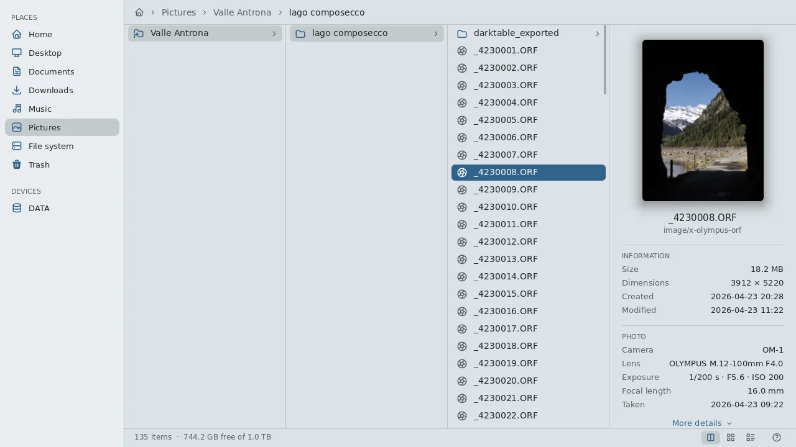

<p align="center"></p>

<h1 align="center">Nordend</h1>

<p align="center">
  <b>A native file manager for Wayland: fast, light and safe.</b><br>
  No GTK, no Qt, no GLib: C++20 straight on Wayland and OpenGL ES.<br>
  At home on any Wayland desktop, and right at home on <a href="https://github.com/noctalia-dev">Noctalia</a>.
</p>

<p align="center">
  <a href="https://github.com/pankaspe/nordend-fm/releases/tag/v0.7.3"></a>
  
  
  
  <a href="https://github.com/pankaspe/nordend-fm/actions/workflows/ci.yml"></a>
  
</p>

<p align="center">
  
  <br>
  <sub>Fifteen seconds of Nordend: columns, grid, Quick Look on raw photos and on code, the command palette, the shortcuts card, in the colours of the desktop's theme.</sub>
</p>

> [!NOTE]
> **Nordend 0.7.3**, the latest release: **scrollbars you can take**. Every list's scrollbar
> widens under the pointer and can be dragged, or clicked beside to jump there; the keyboard
> shortcuts card scrolls when the window is too low for it (issue #12, thanks to llego). Young
> software, used every day by its author. [Install it](#install).

## Contents

- [Why Nordend](#why-nordend)
- [Features](#features)
- [Install](#install) and [keep it current](#nordend-setup)
- [Setting it up](#setting-it-up): [folders and a key](#folders-and-a-key),
  [the file chooser](#as-the-file-chooser-of-other-applications), [colours](#colours),
  [configuration](#configuration)
- [Numbers](#numbers)
- [Versions](#versions)
- [What's next](#whats-next)
- [Documentation](#documentation) · [Development](#development) · [License](#license)

## Why Nordend

Nordend talks to the compositor directly, with **no toolkit at all**: text, icons, scrolling and
animations come from its own renderer.

- **At home on your desktop.** It follows your theme by itself, as GTK apps do, live; it can be
  the Open and Save dialog of other applications; every action has a key and a click.
- **Fast.** The first frame in about 75 ms; a raw photo in Quick Look at once, sharp in about
  100 ms. Every figure is measured, with the tool to measure it again ([Numbers](#numbers)).
- **Light.** A 3.6 MB binary, about 24 MB of memory, no CPU at all while nothing moves.
- **Safe.** Files that come from outside are read in a small helper process caged by Nordend
  (seccomp and landlock: no files, no network, no programs): a broken or hostile file costs at
  most its preview. Nothing is overwritten without asking, nothing half-copied under a real name.

## Features

**Browsing**
- Three views of the same folder: columns, a thumbnail grid, a details table
  (<kbd>Ctrl</kbd>+<kbd>1</kbd> <kbd>2</kbd> <kbd>3</kbd>); switching keeps your place and your
  selection; zoom; sort by name, size, date or type
- Tabs (<kbd>Ctrl</kbd>+<kbd>T</kbd>, or a middle click on a folder), each with its folder, view
  and history, all back at the next start
- Command palette (<kbd>Ctrl</kbd>+<kbd>K</kbd>): every command, place and tab, fuzzy-matched
  (fzy), the recently used first
- Find files (<kbd>Ctrl</kbd>+<kbd>F</kbd>): fuzzy search of every file under the folder, first
  results in milliseconds even among 270 000
- Sidebar: places, GTK bookmarks (renamed, pointed elsewhere and reordered in place), disks
  through udisks2 (mount, unmount, eject)
- Folders follow changes on disk (inotify); history with <kbd>Alt</kbd>+<kbd>←</kbd>
  <kbd>→</kbd> and the mouse's side buttons
- Keyboard first, mouse always: <kbd>F1</kbd> lists every shortcut

**Photos and previews**
- Quick Look (<kbd>Space</kbd>): photos fill the window, raw files included; text files on a
  scrollable page with syntax colours, to select and copy; the arrows walk the folder
- Raw files: the previews cameras embed in ORF, CR2, NEF, ARW, RAF, RW2, SRW, DNG, 3FR, found by
  Nordend's own reader, upright and cropped to the shot; DNGs with only a small preview (Leica,
  drones) developed by Nordend itself, with the file's own colour; EXIF in the info pane
- Images: PNG, JPEG, GIF ([wuffs](https://github.com/google/wuffs), memory-safe by
  construction), WebP, JPEG XL; TIFF, PGM and PPM with Nordend's own readers, checked pixel for
  pixel against libtiff and fuzzed; thumbnails in the shared freedesktop cache
- darktable sidecars travel with their photo through every rename, copy, move and trip to the
  trash

**Files**
- Copy and move with progress and conflict questions, rename, new folder or file from
  templates, undo and redo (<kbd>Ctrl</kbd>+<kbd>Z</kbd>), a real freedesktop trash with
  restore, delete permanently
- Drag and drop within Nordend and with other apps; rubber-band selection; the system clipboard

**On your desktop**
- The file chooser of other applications (the desktop portal's): open and save with Nordend's
  views, thumbnails and Quick Look, the application's filters and choices
- Default applications and "Open With", resolved exactly as GLib does; a terminal in any folder
  (<kbd>F4</kbd>), the one you choose in `config.toml`
- Your theme's colours, live (Noctalia, Stylix, matugen, a hand-made `gtk.css`), or the
  desktop's light/dark style and accent (GNOME, Plasma); the icon follows the accent; fractional
  scaling; one header with the sidebar to the top, the path and the window's buttons
- Remembers views, order, tabs and window size; a short `config.toml`, reloaded live

Everything it does, area by area: [docs/features.md](docs/features.md).

## Install

Nordend needs Linux with a Wayland compositor that offers xdg-shell (developed on Umbriel, also
tried on GNOME, Plasma and niri) and a GPU driver with OpenGL ES 3.0 (Mesa). Four ways, each
opens with a click:

<details>
<summary><b>On any distribution</b>: nordend-setup builds, installs and updates it</summary>

`nordend-setup` is one plain shell script that takes you from nothing to Nordend installed and
set up: it checks your system, shows the exact command that installs what is missing (and asks
before anything that needs sudo), builds the latest release from its source, installs it into
`/usr/local` (or `~/.local`) and can make it your file chooser and folder opener. It knows apt,
dnf, pacman, zypper and xbps; tried in CI on Debian 13, Ubuntu 26.04, Fedora 43, Arch and
openSUSE Tumbleweed. Ubuntu 24.04 and Linux Mint 22 cannot build Nordend (their sdbus-c++ is
1.x): the script says so.

Download it, read it, run it:

```sh
curl -fLO https://raw.githubusercontent.com/pankaspe/nordend-fm/v0.7.3/scripts/nordend-setup
less nordend-setup
sh nordend-setup           # asks what to do; or: sh nordend-setup install
```

It installs itself beside `nordend`, to keep Nordend current later: its commands are below, in
[nordend-setup](#nordend-setup). Nordend itself never goes online: only the script does, when
you run it.

</details>

<details>
<summary><b>On Void Linux</b>: a package built from its xbps-src template</summary>

Nordend is developed on Void, and comes with an xbps-src template in
[`packaging/void`](packaging/void). It builds the latest release into a package that puts
`nordend`, its desktop entry and its icon under `/usr`:

```sh
# 1. void-packages, once (skip if you already have a checkout)
git clone --depth 1 https://github.com/void-linux/void-packages
cd void-packages
./xbps-src binary-bootstrap

# 2. Nordend's template, then the package
git clone --depth 1 https://github.com/pankaspe/nordend-fm /tmp/nordend-fm
cp -r /tmp/nordend-fm/packaging/void/nordend srcpkgs/
./xbps-src pkg nordend
sudo xbps-install -R hostdir/binpkgs nordend
```

The package is the latest release, **0.7.3**. What `main` gains after it comes with the next
release; to have it at once, build from source.

</details>

<details>
<summary><b>On NixOS and with Nix</b>: the flake, built on your machine</summary>

Nordend comes with a flake: [`flake.nix`](flake.nix), and the package in
[`packaging/nix`](packaging/nix). It is not in nixpkgs, and there is no binary cache: Nix builds
it on your machine, in a few minutes, its tests included. Since 0.5.1, for x86_64 Linux, tried
on NixOS 26.05 with GNOME.

```sh
nix run github:pankaspe/nordend-fm           # try it
nix profile add github:pankaspe/nordend-fm   # keep it (nix profile install in older Nix)
```

In a NixOS configuration made with flakes:

```nix
# flake.nix: inputs
nordend.url = "github:pankaspe/nordend-fm";

# a module (with inputs passed in specialArgs)
nixpkgs.overlays = [ inputs.nordend.overlays.default ];
environment.systemPackages = [ pkgs.nordend ];
```

</details>

<details>
<summary><b>From source</b>: on any distribution, with CMake</summary>

On Void Linux the packages are these; on other distributions, `sh nordend-setup status` (above)
prints the command for yours:

```sh
sudo xbps-install -S cmake ninja pkgconf wayland-devel wayland-protocols \
    libxkbcommon-devel libglvnd-devel MesaLib-devel \
    harfbuzz-devel freetype-devel fontconfig-devel tomlplusplus-devel \
    libwebp-devel libjxl-devel zlib-devel sdbus-c++-devel
git clone https://github.com/pankaspe/nordend-fm
cd nordend-fm
cmake -B build -G Ninja
cmake --build build
./build/nordend            # your home folder, or ./build/nordend ~/Pictures
cmake --install build --prefix ~/.local --strip   # nordend, its desktop entry and icon
```

To have Nordend as the file chooser of other applications (below), install it under `/usr`
instead: `sudo cmake --install build --prefix /usr --strip`.

</details>

### nordend-setup

Once Nordend is installed with it, `nordend-setup` sits beside `nordend`. Run it without a
command and it shows where things stand and asks what to do, or name the command:

| Command | What it does |
|---|---|
| `status` | Your system (distribution, compiler, libraries) and Nordend: every copy on your PATH with its version and who installed it, whether it is the file chooser and opens folders. Changes nothing. |
| `check` | Asks GitHub for the newest release and compares it with the one installed. Installs nothing. |
| `update` | Builds the newest release and installs it in place of the old one, with the same choices as the first install (where, and the file chooser's file); removes the files the new version no longer has. Your settings stay as they are. |
| `install` | The first install: checks the system, installs the missing build packages (the exact command shown, one question for sudo), downloads the release, builds it, installs it into `/usr/local` or `~/.local`, then offers `configure`. |
| `configure` | Makes Nordend the file chooser of other applications and the application that opens folders, or gives them back to what you had before; says where to set a key for it. |
| `uninstall` | Gives the file chooser and folders back, then removes every file it installed, and only those. |

A new release, for example:

```sh
nordend-setup check     # ✓ Nordend 0.7.3 is out: nordend-setup update
nordend-setup update    # builds and installs it; your settings stay
```

Options: `--dry-run` shows every command and runs none; `--yes` takes the recommended answer to
every question (for scripts); `--prefix DIR` installs into DIR, or picks the install there;
`--no-color` (or `NO_COLOR`) for plain output; `--help` lists them all.

What it keeps: `share/nordend/install-record` (the version, the commit it was built from, where,
when) and `share/nordend/installed-files` (every file) beside the install; the application that
opened folders before, in `~/.local/state/nordend-setup/settings`; nothing else. It builds in
`~/.cache/nordend-setup` and empties it afterwards. A Nordend installed by a package manager or
Nix is left to it: nordend-setup stops rather than install a second copy.

## Setting it up

With nordend-setup, `nordend-setup configure` does the first two for you.

### Folders and a key

Make Nordend the default for folders (a browser's "Show in folder", `xdg-open`) and give it a
key:

```sh
xdg-mime default nordend.desktop inode/directory
```

```toml
# Umbriel's config.toml; other compositors have their own way
"Mod+E" = { action = "spawn nordend", repeat = false }
```

### As the file chooser of other applications

Nordend can be the Open and Save dialog of other applications, through the desktop portal. It
needs Nordend's `nordend.portal` under `/usr/share` (the Void package installs it; nordend-setup
copies it there), because xdg-desktop-portal looks for its backends only there. Then choose it
for your desktop, once:

```sh
nordend --set-file-chooser     # then log out and in again
```

It adds one line to your `~/.config/xdg-desktop-portal/<desktop>-portals.conf`, keeping the
desktop's other portals; `nordend --unset-file-chooser` takes it out again. Flatpak applications
use the portal by themselves; others only when asked:

- Firefox: `widget.use-xdg-desktop-portal.file-picker` set to `1` in `about:config`
- GTK 4 applications: `GDK_DEBUG=portals` in the session's environment (GTK 3: `GTK_USE_PORTAL=1`)
- Qt applications: `QT_QPA_PLATFORMTHEME=xdgdesktopportal`

### Colours

Nothing to set up: Nordend follows your theme by itself, as GTK apps such as Thunar do. It
reads the colours of your GTK settings (`~/.config/gtk-4.0/gtk.css`, else `gtk-3.0`, and what
they import) and changes with them, live. Whatever themes GTK writes them there: on Noctalia,
its GTK theming (the built-in `gtk4` and `gtk3` templates); Stylix, matugen, or your own
`gtk.css`. Without them, Nordend takes the desktop's light or dark style and accent, where its
portal offers them (GNOME, Plasma), else its own default palette.

### Configuration

Every key, with its default, is in [docs/config.example.toml](docs/config.example.toml): copy it
to `~/.config/nordend/config.toml`; `nordend --check-config` reports any problem. The command
line: `nordend [DIR]`, `--config FILE`, `--version`, `--about` (what Nordend runs on, for a bug
report), and `--set-file-chooser` / `--unset-file-chooser`.

## Numbers

| | |
|---|---|
| Binary | **4.34 MB** (3.61 MB stripped), x86-64; the decoders and text readers in `nordend-preview`, 1.15 MB (1.03 stripped), a separate caged helper; the file chooser's service `nordend-portal`, 0.36 MB (0.29 stripped), started only when an application asks |
| Libraries | 17 direct (the helper and the service: 8 each); no GTK, no Qt, no GLib |
| Code | about 56 900 lines of C++20, 20 700 of tests (489 test cases, under ASan and TSan too) |
| Memory | **24 MB** of its own at start; pictures are decoded in the helpers, which give their memory back after a quiet second |
| Idle | **0 CPU**: nothing is drawn while nothing moves |

The design's four targets (Ryzen 7 5700G, RX 6650 XT, SATA SSD), measured again on 2026-11-13
where the date says so:

| Target | Measured |
|--------|---------:|
| Cold start to the first frame on screen: < 150 ms | **128 ms** (2026-11-01); warm **76 ms** (2026-11-13) |
| A 10 000-file folder: first frame < 50 ms | first entries in **0.8 ms**, all in **19 ms** (2026-11-13) |
| Quick Look of an ORF raw photo: < 100 ms | **110 ms** for a portrait shot, median **about 102** over 18 photos (2026-11-14, from 144 ms): **nearly met**; the thumbnail shows in 20 ms |
| Scrolling with no dropped frame | worst frame **3.7 ms** of 13.3 (75 Hz) (2026-11-01) |

Every measurement and its method is in [docs/benchmarks.md](docs/benchmarks.md).

## Versions

Nordend stays at 0.x while it is young: a new **minor** version (0.7.0) brings features you can
see, a **patch** (0.7.1) only fixes things. 1.0.0 will come once Nordend has been its author's
everyday file manager for a while and its files (`config.toml`, `state.toml`) have settled. The
latest three; every release is in [CHANGELOG.md](CHANGELOG.md):

| Version | What it brought |
|---|---|
| [0.7.3](https://github.com/pankaspe/nordend-fm/releases/tag/v0.7.3), 2026-11-14 | Scrollbars that widen under the pointer and can be dragged, or clicked on their track, in every list and on Quick Look's text pages; the keyboard shortcuts card scrolls in a low window, from llego's issue |
| [0.7.2](https://github.com/pankaspe/nordend-fm/releases/tag/v0.7.2), 2026-11-14 | nordend-setup: install Nordend from its source on any distribution, keep it current with `check` and `update`, set it up with `configure`, remove it with `uninstall`; tried in CI on Debian 13, Ubuntu 26.04, Fedora 43, Arch and openSUSE Tumbleweed |
| [0.7.1](https://github.com/pankaspe/nordend-fm/releases/tag/v0.7.1), 2026-11-14 | Quick Look of a raw photo from 144 to 110 ms on screen, grid thumbnails faster (the image scaler rewritten); the sidebar's bookmarks renamed, pointed elsewhere and reordered, from Evergaster's issue |

## What's next

Nordend stays what it is: a native C++ file manager, at home on any Wayland desktop and right at
home on Noctalia, with no GTK or Qt; very light, safe and fast. Everything else is a feature on
top, added only when it keeps those three. Coming, roughly in this order:

- **Network shares** in the sidebar (Samba, SFTP, FTP, WebDAV, through gvfs when it runs)
- **Previews, one family at a time**: other common formats one by one (SVG, AVIF, fonts,
  archive contents, audio tags)
- Colour labels and star ratings of your own, not tied to any raw editor
- A Quick Look for photographers: 100 % zoom, EXIF, histogram, comparison
- A dual pane, a queue of operations and batch renaming
- Translations; plugins in Luau (one system, each plugin caged, for things outside Nordend such
  as local AI search)

## Documentation

[Features](docs/features.md) ·
[Changelog](CHANGELOG.md) ·
[Devlog](docs/devlog.md) ·
[Benchmarks](docs/benchmarks.md) ·
[Compatibility](docs/compatibility.md) ·
[Upstream bug log](docs/buglog.md)

## Development

Contributions are welcome: bug reports, fixes, and features after a short discussion in an issue.
See [CONTRIBUTING.md](CONTRIBUTING.md).

Nordend is copiloted by **Claude Opus** (Anthropic), which assists with code writing, code analysis,
bug hunting, testing and documentation. Design decisions, testing on real hardware and every release
are the author's. Step numbers in code comments ("ROADMAP 6.3") refer to the internal roadmap.

## License

[MIT](LICENSE). Third-party code and data (the wuffs decoder, the Tabler icons, Noctalia's default
palette) are listed in [THIRD_PARTY.md](THIRD_PARTY.md).
